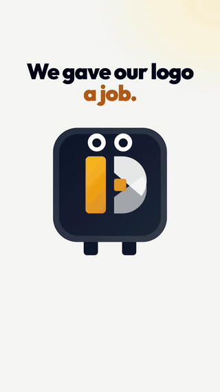
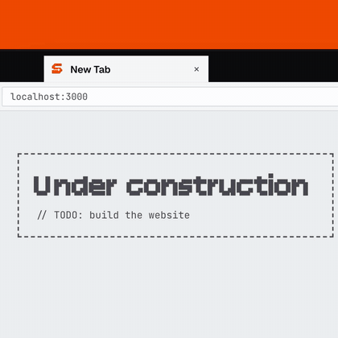
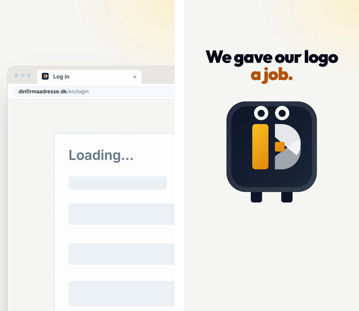

# brand-film

**Your logo, alive, building your product, in 14 seconds of video. Written as code, rendered on a laptop in about 10 seconds.**

An agent skill for Claude Code and Codex. Point it at your site: it reads your brand, interviews you, proposes a beat sheet, then makes a short character film where your own logo escapes its browser tab and builds your real product screen, one beat-locked hop at a time. You get a 9:16 film for Reels/TikTok/Shorts, a 1:1 cut for X and LinkedIn, both thumbnails and a caption.

No After Effects. No Blender. No GPU. No stock footage.

<table>
<tr>
<td width="320"></td>
<td>

**"Your post, handled."** for [Din Firmaadresse](https://www.dinfirmaadresse.dk)

The logo logs into its own customer portal, sorts three letters, gets caught by the scanner and lands in its own mailbox, then stamps the invoice PAID.

14 s · 1080×1920 · effects-only sound for a Reels library track
[Watch with sound (9:16)](media/films/post-handled-9x16.mp4) · [1:1 cut](media/films/post-handled-1x1.mp4)

</td>
</tr>
<tr>
<td width="320"></td>
<td>

**"Built by a 16px favicon."** for [Solidinput](https://www.solidinput.eu)

The pixel "S" favicon escapes its tab, smashes the placeholder and builds the homepage. Mid-film joke: it vanishes on its own orange.

13.5 s · 1080×1080 · synthesized chiptune score
[Watch with sound](media/films/favicon-escape-1x1.mp4)

</td>
</tr>
</table>

## The first frame decides

On X and Reels the first frame is the thumbnail. The first cut of "Your post, handled." opened on a browser tab and a loading card. The skill now opens every film on a hook frame: the logo big, eyes open, under a two-line hook, then it hops into its tab and the story starts.



## Install

```bash
# Claude Code
git clone https://github.com/solidinput/brand-film ~/.claude/skills/brand-film

# Codex
git clone https://github.com/solidinput/brand-film ~/.agents/skills/brand-film
```

Needs Node.js 22+ and ffmpeg. Python 3 with numpy and scipy for the sound (the skill makes its own venv). [HyperFrames](https://github.com/heygen-com/hyperframes) runs through `npx`, nothing to install.

Then ask your agent:

```
/brand-film https://your-site.com — the logo builds our onboarding: sign up, connect, first report. End line "Reports, done." Reels and X.
```

## What it does

1. **Reads the brand.** Screenshots of your site at desktop and phone width; in a repo, your `DESIGN.md`, logo SVG, interface strings and prices.
2. **Interviews you, once.** One message with what it could not find, each question with a proposed default: what the product does in a customer's words, who watches, the payoff moment, the 3-5 screens the logo builds, one surprise only your product can do, which names may be on screen, the hook and end lines, formats, sound.
3. **Proposes a beat sheet** (time → action → what changes → sound) and waits for a yes.
4. **Builds the scene in HTML** in your colours and fonts. One paused GSAP tween drives a pure `render(t)`: every hop, squash, blink and text change is a function of time, so any frame can be re-rendered and the same source always gives the same film.
5. **Checks before rendering.** HyperFrames layout, contrast and platform safe-area checks, then stills of every landing read as a contact sheet.
6. **Writes the sound in Python**: a chiptune or soft score, or effects only, every effect on its frame.
7. **Renders** the 9:16 master and the 1:1 cut, exports both thumbnails, writes the caption and a "how we made it" thread. It never posts anything.

## Rules it keeps

- Real product, real copy, real prices. No demo personas, no customer data, no private emails, no invented numbers.
- Your logo only. It will not animate another company's mascot.
- Text and action stay out of the Reels/TikTok UI on vertical video.

## Layout

```
SKILL.md                 the workflow and the interview
references/method.md     engine, layout math, hook opening, square cut, every lesson so far
references/x-thread.md   caption and thread templates
example/                 Solidinput, 1:1, pixel hero, chiptune (scripts/score.py)
example-reels/           Din Firmaadresse, 9:16 master, hook opening, effects-only sound
example-square/          the same film cut for X
media/                   the GIFs and films above
```

Both Din Firmaadresse cuts rebuild from `example-reels/` and `example-square/` alone and match the delivered films frame for frame.

## Credits

- The idea of a character building a real interface as code, with sound on the same timeline, comes from the Clawd Motion Lab "No After Effects" prompt.
- [HyperFrames](https://github.com/heygen-com/hyperframes) by HeyGen (Apache-2.0) renders HTML to MP4. Animation runs on [GSAP](https://gsap.com).
- Related: [motion-studio](https://github.com/DanielDerefaka/motion-studio) takes a similar idea into Blender and 3D.

The logos and product screens in `example*/` and `media/` belong to Solidinput and Din Firmaadresse. They are here as worked examples; do not reuse them for your own films.

## Want one made for you?

[Solidinput](https://www.solidinput.eu) builds these films for software products.

## License

MIT for the code and docs. See [LICENSE](LICENSE).
